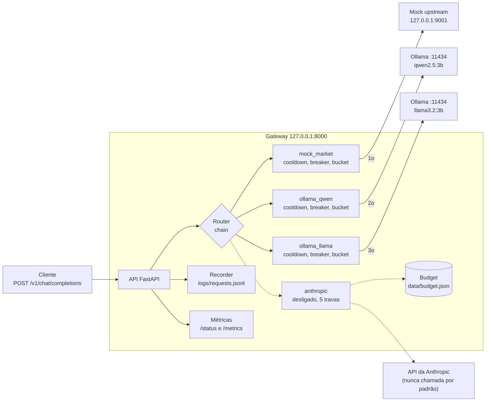
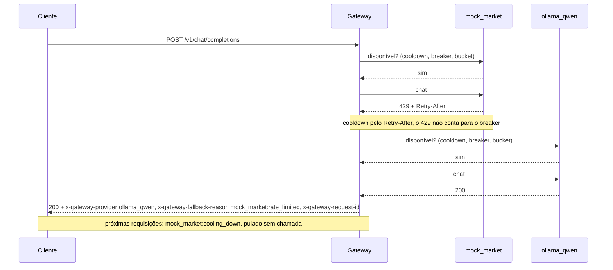
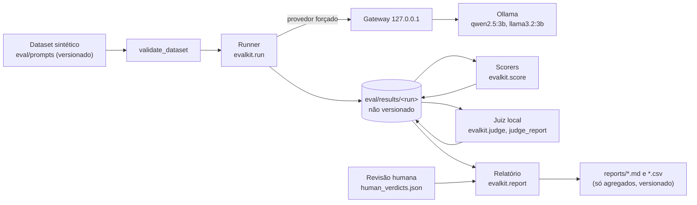

# llm-gateway-study

Um LLM Gateway em Python que tenta um provedor "de mercado" simulado e, quando ele limita, falha ou
fica lento demais, redireciona a requisição para modelos locais (Qwen e Llama via Ollama).

> **Projeto de estudo, sem garantias.** Código didático para entender roteamento com fallback em um
> gateway de LLMs. Não use em produção. Licença [MIT](LICENSE).

## O que o projeto mostra

- **Rate limit simulado:** um mock de provedor de mercado que pode devolver 429 (com `Retry-After`),
  5xx ou ficar lento, controlado em tempo de execução por uma API de chaos.
- **Fallback para modelos locais:** o gateway percorre uma `chain` de provedores e cai para o próximo
  quando o atual falha, sem o cliente perceber (só pelos headers `x-gateway-*`).
- **Token bucket local:** limite de requisições (e tokens) por minuto, aplicado antes de chamar o provedor.
- **Circuit breaker e cooldown:** depois de N falhas seguidas o provedor deixa de ser chamado; um 429
  coloca o provedor em cooldown pelo `Retry-After`. Recuperação por `half_open` com sonda.
- **Observabilidade:** `GET /status`, `GET /metrics` (Prometheus) e um recorder JSONL por requisição.
- **Custo sob controle:** a API real da Anthropic vem **desligada** e atrás de cinco travas (veja
  [Custo e segurança](#custo-e-segurança)).

## Arquitetura



### Uma requisição com fallback por 429



O gateway e o mock escutam **somente em `127.0.0.1`** (o bind não é configurável). O provedor
`anthropic` fica fora da `chain` e desabilitado.

## Pré-requisitos

- Python 3.11+ (desenvolvido e testado com 3.12).
- [Ollama](https://ollama.com) rodando, com os dois modelos usados pela demo:

```powershell
ollama pull qwen2.5:3b
ollama pull llama3.2:3b
```

Os testes padrão não precisam do Ollama nem de credenciais.

## Início rápido (Windows / PowerShell)

```powershell
git clone <url-do-repositorio> llm-gateway-study
cd llm-gateway-study
python -m venv .venv
.venv\Scripts\Activate.ps1
pip install -r requirements.txt
Copy-Item .env.example .env      # o .env nunca é versionado; o padrão já deixa a API real desligada
python scripts/demo.py
```

Se o PowerShell bloquear o `Activate.ps1`, use `.venv\Scripts\python` no lugar de `python` (por exemplo
`.venv\Scripts\python scripts/demo.py`), ou libere scripts só para a sessão com
`Set-ExecutionPolicy -Scope Process RemoteSigned`.

### A demo (`scripts/demo.py`)

Sobe o mock e o gateway como **processos reais**, em portas livres e `127.0.0.1`, usando uma cópia
temporária de [config.demo.yaml](config.demo.yaml), e conta a história em seis cenas:

| # | Cena | O que acontece |
|---|---|---|
| 1 | Normal | O mock responde; o `mock_market` atende. |
| 2 | Rate limit do provedor | Mock em `rate_limit` (429 + `Retry-After`): fallback para o Qwen e cooldown; as próximas requisições pulam o mock sem chamá-lo. |
| 3 | Falha do provedor | Mock em `server_error`: o breaker abre depois de 3 falhas e o `/stats` do mock confirma que ele deixou de ser chamado. |
| 4 | Recuperação | Mock volta ao normal; passado o cooldown o breaker vai a `half_open`, uma sonda passa e ele fecha. |
| 5 | Limite local | Mais requisições que o balde de 10 rpm: `rate_limit_local` e fallback para o Qwen. |
| 6 | Tudo indisponível | Força um único provedor indisponível e mostra o 503 com o motivo por provedor. |

O "Limite local" vem depois das cenas que precisam chamar o mock: ele esvazia o balde do
`mock_market`, que reabastece só 1 requisição a cada 6 s. Na cena 6 só o `mock_market` e o `anthropic`
são forçados: os modelos locais não são derrubados de propósito.

Flags: `--fast` (cooldowns de 2 s, só para teste), `--no-color` e `--skip-ollama-check` (não
recomendado). A demo verifica se o Ollama responde e se os dois modelos existem; se faltar algo, sai
com a instrução (`ollama pull ...`) e **nunca baixa modelos sozinha**. Ela faz o warm-up dos modelos
locais na subida, então a primeira resposta local pode demorar. Tudo o que ela grava (budget, recorder,
logs dos processos) vai para um diretório temporário removido no final; `data/` e `logs/` do
repositório não são tocados. Os processos filhos sobem com `ENABLE_REAL_API=0` e sem chave da Anthropic.

Um trecho da saída (prompts genéricos; as respostas dos modelos locais variam):

```text
=== Cena 2: Rate limit do provedor ===
O mock devolve 429 com Retry-After=10s: fallback para o Qwen e cooldown (as proximas requisicoes pulam o mock sem chama-lo).
+---+------------+--------+-------------+----------------------------+---------------+-------------------------------+
| # | cena       | status | provedor    | fallback (provedor:motivo) | latencia (ms) | resposta (40 chars)           |
+---+------------+--------+-------------+----------------------------+---------------+-------------------------------+
| 4 | rate_limit |    200 | ollama_qwen | mock_market:rate_limited   |            61 | Happy                         |
| 5 | rate_limit |    200 | ollama_qwen | mock_market:cooling_down   |            87 | One common fruit is an apple. |
| 6 | rate_limit |    200 | ollama_qwen | mock_market:cooling_down   |            49 | Yes.                          |
+---+------------+--------+-------------+----------------------------+---------------+-------------------------------+
estado: mock_market: breaker=closed(0 falhas) rpm=6.0/10 cooldown=9.8s | ollama_qwen: breaker=closed(0 falhas) | ...
/stats do mock: recebidas=1 por_status={429:1}
confirmado: o mock recebeu 1 requisicao(oes) de 3; as demais foram puladas por cooldown.

Resumo (via GET /metrics)
  requisicoes por provedor:
    ollama_qwen: 11
    mock_market: 9
    none (503/erro do gateway): 2
  total de requisicoes: 22
  total de fallbacks: 13
```

## Rodar à mão

Em dois terminais, com a venv ativa:

```powershell
python -m mock_upstream.server     # terminal 1: mock em 127.0.0.1:9001
python -m gateway.main             # terminal 2: gateway em 127.0.0.1:8000 (config.yaml)
```

Uma requisição (formato OpenAI). `Invoke-WebRequest` mostra os headers do gateway:

```powershell
$body = '{"messages":[{"role":"user","content":"Say hello in one word."}],"max_tokens":20}'
$r = Invoke-WebRequest -Method Post -Uri http://127.0.0.1:8000/v1/chat/completions `
       -ContentType "application/json" -Body $body -UseBasicParsing
$r.Headers["x-gateway-provider"]          # quem respondeu
$r.Headers["x-gateway-fallback-reason"]   # ausente quando não houve fallback
$r.Content

# fazer o mock devolver 429 e repetir a requisição: o Qwen responde
Invoke-RestMethod -Method Post -Uri http://127.0.0.1:9001/chaos -ContentType "application/json" `
  -Body '{"mode":"rate_limit","retry_after_seconds":5}'
$r = Invoke-WebRequest -Method Post -Uri http://127.0.0.1:8000/v1/chat/completions `
       -ContentType "application/json" -Body $body -UseBasicParsing
$r.Headers["x-gateway-provider"]          # ollama_qwen
$r.Headers["x-gateway-fallback-reason"]   # mock_market:rate_limited
```

Com `curl.exe`, o corpo vai por arquivo (o PowerShell 5.1 estraga as aspas e os espaços de um JSON
passado direto em `-d`):

```powershell
$f = Join-Path $env:TEMP "body.json"
Set-Content -Path $f -Encoding ascii -Value '{"messages":[{"role":"user","content":"Say hello in one word."}],"max_tokens":20}'
curl.exe -i http://127.0.0.1:8000/v1/chat/completions -H "content-type: application/json" -d "@$f"
```

Para rodar à mão com os limites da demo, aponte o gateway para o outro YAML (o `uvicorn` usa a
variável `GATEWAY_CONFIG`):

```powershell
$env:GATEWAY_CONFIG = "config.demo.yaml"
python -m uvicorn gateway.main:app_factory --factory --host 127.0.0.1 --port 8000
```

Streaming (`stream=true`) não é suportado (400). O `model` enviado pelo cliente é aceito, mas
substituído pelo `model` do provedor.

## Referência

### Configuração (`config.yaml`)

`config.yaml` é o de uso geral (sem limites artificiais). `config.demo.yaml` tem os limites da demo
(`mock_market` com `rpm: 10`, breaker com `cooldown_s: 10`, `warmup` nos Ollama, force-provider ligado).
Os dois são validados pelo mesmo schema pydantic na inicialização: nome duplicado, nome inexistente ou
repetido na `chain` e campos desconhecidos (como `api_key`) falham com mensagem clara. **Segredos nunca
ficam no YAML.**

| Chave | Descrição |
|---|---|
| `gateway.port` | Porta do gateway (padrão 8000). O bind é sempre `127.0.0.1`. |
| `gateway.force_provider_enabled` | Padrão `false`. Se `true`, vale o header `x-gateway-force-provider`. |
| `mock_upstream.port` | Porta do mock (padrão 9001). |
| `chain` | Ordem de tentativa, por nome de provedor, sem repetição. |
| `budget` | `limit` (padrão 30) e `path` (padrão `data/budget.json`). |
| `recorder` | `path` (padrão `logs/requests.jsonl`) e `record_content` (padrão `true`). |

Campos de cada item de `providers[]`:

| Campo | Padrão | Descrição |
|---|---|---|
| `name`, `type` | (obrigatórios) | `type`: `mock`, `ollama` ou `anthropic`. |
| `base_url` | (obrigatório em `mock`/`ollama`) | O `anthropic` não tem: o host é fixo no código. |
| `model` | (obrigatório) | Modelo enviado ao provedor (o do cliente é ignorado). |
| `timeout_s` | 30 | Prazo **total** da tentativa; estourar conta como `timeout`. |
| `context_window` | (obrigatório) | Em tokens. Estimativa de entrada: caracteres/4. |
| `enabled` | `true` | Desabilitado aparece como `disabled` no header de fallback. |
| `rate_limit` | sem limite | `{rpm, tpm}`; `null` desativa o respectivo balde. |
| `breaker` | `{failure_threshold: 3, cooldown_s: 30, half_open_max_calls: 1}` | Circuit breaker. |
| `default_retry_after_s` | 30 | Cooldown de um 429 sem `Retry-After`. |
| `warmup` | `false` | Só Ollama: requisição mínima (`max_tokens=1`) na inicialização. |
| `real_api_max_input_tokens`, `max_tokens_cap` | 1000, 50 | Só `anthropic`: tetos da chamada real. |

Todos os números devem ser > 0.

### Roteamento e falhas

Ordem em cada tentativa: desabilitado, contexto grande, cooldown, breaker, token bucket, chamada.

| Situação | Resultado |
|---|---|
| 429 / 5xx / timeout / erro de conexão | `rate_limited` / `server_error` / `timeout` / `connection_error`: fallback |
| 401 / 403 | `auth_error`: fallback e aviso no log |
| 2xx sem JSON válido | `invalid_response`: fallback |
| Provedor desabilitado | `disabled`: pulado |
| Prompt não cabe em `context_window` | `context_too_large`: pulado |
| Cooldown / breaker aberto / balde vazio | `cooling_down` / `breaker_open` / `rate_limit_local`: pulado, **sem chamar** |
| Anthropic bloqueada | `real_api_blocked` / `budget_exhausted` / `input_too_large`: fallback, não conta para o breaker |
| Outro 4xx | Erro do cliente devolvido como veio, **sem** fallback |
| Todos falharam | 503 com `error.providers` = `{provedor: motivo}` e `Retry-After` (menor espera informada) |

O circuit breaker abre após N falhas **consecutivas** (`server_error`, `timeout`, `connection_error`,
`invalid_response`, `auth_error`); um sucesso zera. Passado o `cooldown_s` vai a `half_open` e deixa
passar até `half_open_max_calls` sondas: sucesso fecha, falha reabre. O token bucket reabastece de forma
contínua (burst = rpm) e o TPM é corrigido para o `usage.total_tokens` real em caso de sucesso.

### Headers do gateway

| Header | Sentido | Significado |
|---|---|---|
| `x-gateway-provider` | resposta | Provedor que respondeu (ausente no 503). |
| `x-gateway-fallback-reason` | resposta | `provedor:motivo,...` dos pulados/falhos; ausente sem fallback. |
| `x-gateway-request-id` | resposta | uuid4 da requisição, o mesmo do recorder e dos logs. |
| `x-gateway-force-provider` | requisição | Tenta só aquele provedor, sem fallback. Só vale com `force_provider_enabled: true`; nome desconhecido dá 400. Respeita cooldown, breaker e bucket. |

### API de chaos do mock

`POST /chaos` **substitui a configuração inteira**: campos omitidos voltam ao padrão (envie sempre o
payload completo). Valores inválidos retornam 422.

| Endpoint | O que faz |
|---|---|
| `POST /chaos` | Define o comportamento. |
| `GET /chaos` | Mostra a config atual. |
| `POST /chaos/reset` | Volta ao modo `normal`. |
| `GET /stats` | Requisições recebidas no chat, total e por status devolvido. |
| `POST /stats/reset` | Zera os contadores. |
| `GET /health` | `{"status": "ok"}`. |

| Campo | Padrão | Descrição |
|---|---|---|
| `mode` | `normal` | `normal`, `rate_limit` (429 + `Retry-After`), `server_error`, `slow` |
| `retry_after_seconds` | `1` | Valor do header `Retry-After` (>= 0) |
| `error_status` | `500` | Status do `server_error`: `500` ou `503` |
| `latency_ms` | `0` | Espera do modo `slow` (>= 0) |
| `fail_every_n` | `null` | Falha a cada N-ésima requisição, em qualquer modo (>= 1). O contador reinicia a cada `POST /chaos` |
| `fail_status` | `500` | Status da falha periódica (400 a 599; 429 inclui `Retry-After`) |

A resposta normal é um eco determinístico do último prompt, prefixado com `[mock]`, com `usage`.

### `GET /status`

Somente leitura e sem segredos (nada de `base_url` ou chaves). Por provedor: `type`, `enabled`,
`breaker` (`state`, `consecutive_failures`, `open_remaining_s`), `buckets` (`rpm`/`tpm` com `level` e
`capacity`, ou `null` sem limite) e `cooldown_remaining_s`. No topo: `budget` (`used`, `limit`,
`remaining`) e `real_api_enabled` (só o booleano de `ENABLE_REAL_API=1`).

### `GET /metrics`

Formato Prometheus, com registry próprio por app e labels de baixa cardinalidade (nunca `request_id`,
prompt ou modelo livre).

| Métrica | Labels | Como ler |
|---|---|---|
| `gateway_requests_total` | `provider`, `status` | Uma por requisição. `provider` é quem respondeu; `none` no 503 e nos 400 do gateway. |
| `gateway_fallback_total` | `from_provider`, `to_provider`, `reason` | Cada provedor pulado/falho; `to_provider` é quem acabou respondendo (`none` no 503). Some por `reason` para ver por que o fallback acontece. |
| `gateway_latency_seconds` | `provider` | Histograma só de chamadas efetivamente feitas (pulados não entram). |
| `gateway_breaker_state` | `provider` | 0 closed, 1 half_open, 2 open; calculado no scrape. |
| `gateway_real_api_calls_total` | | Chamadas reais (reservas do budget). Deve ficar em 0. |
| `gateway_budget_remaining` | | Chamadas reais restantes. |

### Recorder (`logs/requests.jsonl`)

Uma linha JSON por requisição (inclusive 503 e erros de cliente), pensada como insumo da Fase 3. O
arquivo guarda prompts e respostas, por isso fica em `logs/` (ignorado pelo git).

| Campo | Conteúdo |
|---|---|
| `request_id`, `timestamp` | uuid4 (igual ao header) e hora UTC. |
| `messages`, `temperature`, `max_tokens` | A requisição. |
| `provider`, `forced_provider`, `fallback_reason` | Quem respondeu (`none` no 503), se foi forçado, e o `provedor:motivo,...`. |
| `status`, `latency_ms`, `usage` | Resultado. |
| `response` | Texto do assistente (`null` nas falhas). |

Com `record_content: false` só vão os metadados. Padrões de segredo são mascarados, e uma falha de
gravação nunca derruba a requisição. Os logs de aplicação registram apenas `request_id`, provedor,
motivo e latência: nunca prompt, resposta ou chaves.

## Custo e segurança

**A API real da Anthropic vem desligada.** O `AnthropicProvider` só abre conexão se **todas** as
condições forem verdadeiras:

1. `ENABLE_REAL_API=1` (padrão `0`; lido do ambiente e do `.env`);
2. `ANTHROPIC_API_KEY` presente (lida do ambiente só no momento do uso);
3. provedor com `enabled: true` no YAML (e, para entrar no fluxo, na `chain` ou forçado);
4. entrada estimada <= `real_api_max_input_tokens` (padrão 1000, estimativa caracteres/4);
5. `budget.reserve()` com sucesso.

Qualquer falha devolve um motivo tipado (`real_api_blocked`, `input_too_large`, `budget_exhausted`)
**sem abrir conexão**, com fallback e sem tocar o breaker. As checagens baratas vêm antes da reserva,
então um bloqueio não gasta orçamento. O host é fixo no código, o `model` vem do config e
`max_tokens` efetivo é `min(request, max_tokens_cap)`.

**Contador persistente** (`data/budget.json`, fora do git): limite rígido (padrão 30). A reserva
acontece **antes** de enviar e nunca é devolvida: falha, timeout e erro também contam. Lock de arquivo
e escrita atômica; arquivo corrompido conta como esgotado e **nunca** é reiniciado em silêncio. O reset é
manual e pede confirmação:

```powershell
python scripts/reset_budget.py
```

A demo e os testes **nunca** chamam a Anthropic: a demo sobe os processos com `ENABLE_REAL_API=0` e sem
chave, e os testes usam só `httpx.MockTransport` com bloqueio de rede externa.

**Segredos nunca são versionados.** O `.env` (ignorado pelo git) é o único lugar da chave; o
`.env.example` só tem placeholder. A chave nunca aparece em logs, exceções, `/status`, `/metrics` nem no
recorder (padrões `sk-...` e o valor da chave do ambiente são mascarados).

```powershell
python scripts/check_secrets.py             # arquivos versionados e novos
python scripts/check_secrets.py --history   # inclui todo o histórico do git
python scripts/install_hooks.py             # instala o hook de pre-commit (rode em cada clone)
```

O `check_secrets.py` retorna 1 se achar chaves, e-mails pessoais ou caminhos absolutos do Windows, e a
saída nunca mostra o valor encontrado. O hook de pre-commit roda esse scan e **bloqueia o commit** se
ele falhar. Não encadeie o scan e o commit sem `&&`.

## Fase 3: avaliação

Compara os dois modelos locais, **Qwen (`qwen2.5:3b`) contra Llama (`llama3.2:3b`)**, passando pelo gateway com o
provedor forçado, em 48 prompts sintéticos em PT-BR (6 categorias x 8). **Esta fase não usa a Anthropic**: nenhuma
chamada, nenhuma chave; o runner recusa rodar se `ENABLE_REAL_API` estiver ligada. Ela também **não mede a perda em
relação a um modelo de mercado** (isso seria a Fase 3b).



### Reproduzir

Precisa do Ollama com os dois modelos e, para a similaridade da summarization, de `pip install -r
requirements-eval.txt` (o modelo de embedding só é lido do cache local; baixar exige `--allow-download`).
Os resultados vão para `eval/results/` (ignorado pelo git: contêm as respostas dos modelos).

```powershell
python -m evalkit.validate_dataset
python -m evalkit.run --provider ollama_qwen  --run-id meu-run
python -m evalkit.run --provider ollama_llama --run-id meu-run
python -m evalkit.score --run-id meu-run
python -m evalkit.judge --run-id meu-run --judge ollama_qwen
python -m evalkit.judge --run-id meu-run --judge ollama_llama
python -m evalkit.judge_report --run-id meu-run
python -m evalkit.report --run-id meu-run        # grava reports/fase3-qwen-vs-llama.md e .csv
```

O relatório não precisa de rede nem de Ollama (lê só os arquivos do run) e é determinístico. Sem o juiz ou sem
`human_verdicts.json` ele gera as seções correspondentes como "não executado".

### Resultado

Detalhes, métodos e avisos em [reports/fase3-qwen-vs-llama.md](reports/fase3-qwen-vs-llama.md) (tabelas em
[CSV](reports/fase3-qwen-vs-llama.csv)). Em resumo, **neste conjunto de 48 prompts**:

- Aprovação de 87,5% (IC95% 75% a 94%) para o Qwen e 64,6% (IC95% 50% a 77%) para o Llama.
- Pareado: diferença média de score de 0,15 (IC95% 0,06 a 0,26), McNemar 12 x 1 (p=0,0034): diferença detectada a
  favor do Qwen, só para este conjunto.
- Por categoria (8 prompts cada), nenhuma comparação é conclusiva: "indicativo, não conclusivo".
- O juiz local (um modelo de 3B julgando outro) **não é confiável**: kappa de 0,17 e 0,23 contra os scorers
  determinísticos, abaixo do critério fixado antes da execução (kappa >= 0,6 e acurácia >= 80%).
- Revisão humana de 16 itens (mais 3 extras): concordou com o scorer em todos, com ressalvas registradas no relatório.

### Limitações da avaliação

Dataset pequeno e sintético; dois modelos de 3B; uma execução por prompt; o enunciado de `reasoning` proíbe
explicar; a summarization recebe crédito parcial por pontos-chave compostos, então sua aprovação é um teto; latências
de modelo quente em GPU. Os avisos completos estão na Seção 2 do relatório.

## Testes, cobertura e lint

```powershell
pytest                          # suíte padrão (sem integração), em ordem aleatória (pytest-randomly)
pytest -p no:randomly           # ordem fixa, para depurar
pytest -p randomly --randomly-seed=1234   # reproduz uma ordem específica
pytest --cov                    # cobertura de gateway/ e mock_upstream/ (falha abaixo de 85%)
pytest -m integration           # precisa do Ollama real em localhost:11434
ruff check .                    # lint
```

- O mapa requisito -> teste está em [docs/TEST_MATRIX.md](docs/TEST_MATRIX.md).
- Os testes nunca falam com a internet: uma fixture `autouse` só deixa abrir conexão para loopback e falha
  o teste se algo tentar sair. Nenhum teste escreve em `data/` nem `logs/` do repositório.
- Os testes de integração sobem o mock e o gateway como processos reais em portas livres e encerram tudo
  no final. Sem o Ollama, eles fazem `skip` com mensagem clara.
- Os testes da demo (`tests/test_demo.py`) rodam as cenas em memória, sem Ollama e sem processos.
- O CI ([.github/workflows/ci.yml](.github/workflows/ci.yml)) roda `check_secrets.py --history`, `ruff` e
  `pytest --cov` em Python 3.12 numa matriz `ubuntu-24.04` + `windows-latest` (exercita os dois ramos do
  lock do budget, `fcntl` e `msvcrt`), sem integração e sem segredos.

## Limitações conhecidas

- Sem streaming (`stream=true` retorna 400).
- A estimativa de tokens é aproximada (caracteres/4); acima do contexto real o Ollama trunca o prompt em
  silêncio, por isso a `context_window` dos locais (3072) fica abaixo do contexto carregado (4096).
- Os modelos locais são pequenos (3B) e de contexto limitado; a qualidade das respostas não é comparável
  à de um modelo de mercado.
- O estado de cooldown, breaker, buckets e métricas fica em memória: reiniciar o gateway zera tudo, e
  várias instâncias não compartilham estado. O recorder e o budget assumem um único processo.
- O mock não imita todos os comportamentos reais: não há streaming, limites por tokens, headers
  `x-ratelimit-*` nem variações de formato entre provedores.
- Desenvolvido e testado no Windows. O ramo `fcntl` do budget e o workflow de CI no Linux ainda não foram
  exercitados.

## Roadmap

- **Fase 1 (este repositório):** gateway, mock, resiliência, observabilidade, custo e demo. Concluída.
- **Fase 3 (concluída, local):** avaliação de Qwen contra Llama via gateway, sem Anthropic
  ([relatório](reports/fase3-qwen-vs-llama.md)).
- **Fase 3b (planejada):** baseline de um modelo de mercado (Claude) nos mesmos prompts, para medir a perda real.
  Depende de autorização explícita.
- **Fase 2 (planejada):** comparar com o LiteLLM Proxy.
